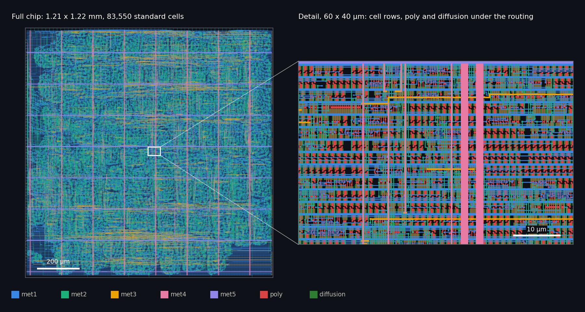
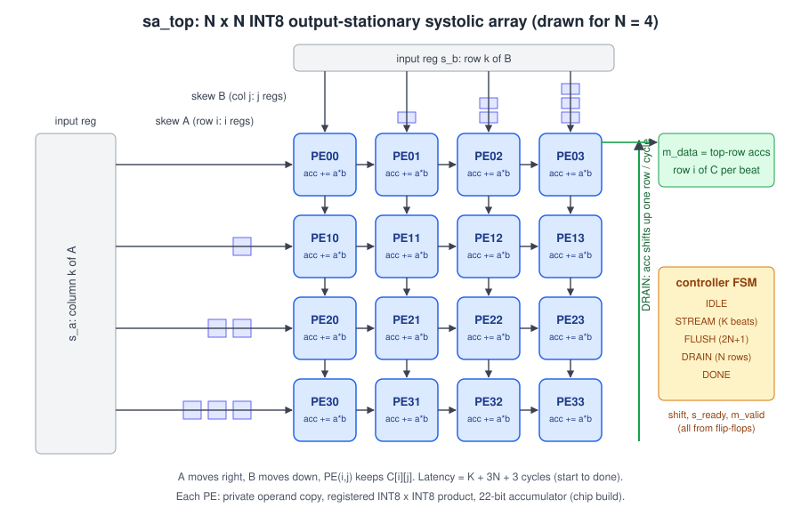
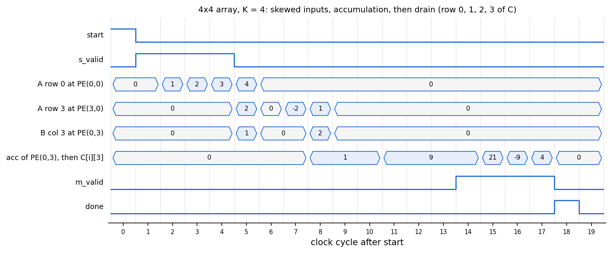
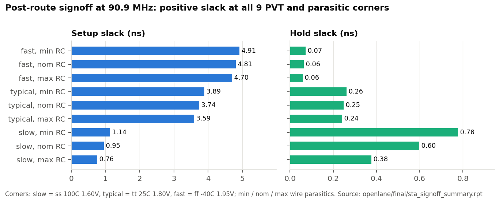
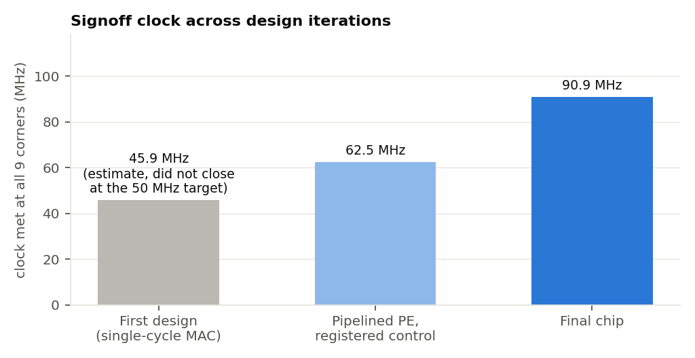
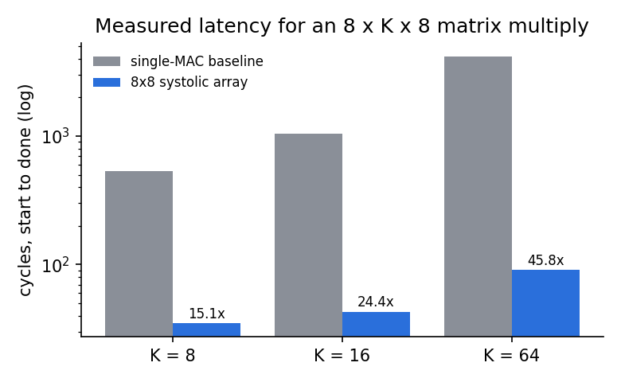
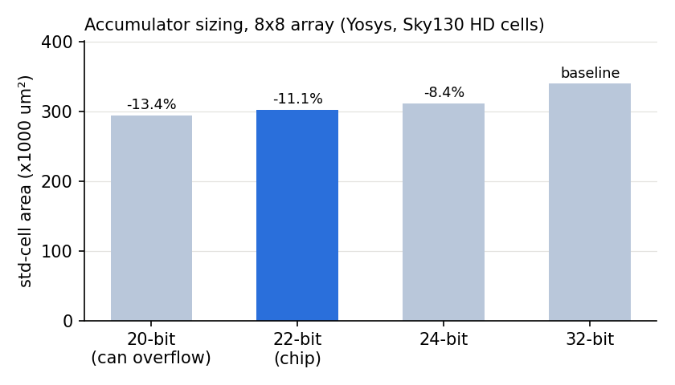

# INT8 Systolic-Array Accelerator: RTL to GDS on Sky130

A TPU-style **8 x 8 INT8 systolic array** for matrix multiplication, written in Verilog-2005, verified against a NumPy golden model with cocotb, formally checked at the processing-element level, and implemented with the open-source LibreLane (OpenLane 2) flow to a **DRC- and LVS-clean GDS on SkyWater Sky130 that meets timing at 90.9 MHz across all 9 PVT and parasitic corners**.

**Highlights**

- **90.9 MHz** signoff at all **9** corners with **0** DRC, LVS and antenna errors, in a **1.48 mm²** die with **83,550** standard cells.
- **11.6 GOPS** peak and **8.2 GOPS** effective throughput, a **46x** speedup over a single-MAC baseline at K = 64.
- **10,000** random matrices (**640,000** outputs) checked against NumPy with **0** mismatches, plus a formal proof of the PE and gate-level simulation of the routed chip.
- Clock raised **45%** (62.5 to 90.9 MHz) by timing-closure work on high-fanout control nets; max-slew warnings cut from **10,747** to **100**.
- **125.7 GOPS/W** from switching activity of the routed netlist; accumulator right-sizing saves **11.1%** cell area.

[](https://github.com/nivi9944/systolic-array/actions/workflows/ci.yml)


[](LICENSE)

`Verilog-2005` · `cocotb` · `NumPy` · `Icarus Verilog` · `Verilator` · `Yosys` · `LibreLane / OpenROAD` · `Magic` · `KLayout` · `Netgen` · `OpenSTA`



*Final routed chip. Cells are placed by OpenROAD's timing-driven placer on a flat netlist, so the 64 PEs form clusters rather than a drawn grid; the regular straps are the met4 / met5 power network.*

---

## Overview

Matrix multiplication dominates neural-network inference, and systolic arrays are how accelerators such as Google's TPU perform it efficiently: operands are read once and passed between neighbouring processing elements, so memory bandwidth per operation stays low. This project builds one end to end, the way a digital ASIC block is built in industry:

1. **RTL** for a parameterised N x N output-stationary array with streaming valid/ready interfaces.
2. **Verification** with directed and random cocotb tests against NumPy, a formal k-induction proof of the PE, and simulation of the final routed netlist.
3. **Physical design** on Sky130 through synthesis, floorplan, placement, clock-tree synthesis, routing, 9-corner static timing analysis, DRC, LVS and antenna checks.
4. **Measurement** of performance, area and power, with every number in this README generated from the JSON files in [`results/`](results/).

## Key results

| Area | Metric | Result |
|---|---|---|
| Timing | Clock met at all 9 corners (ss / tt / ff x min / nom / max RC) | **90.9 MHz** |
| Timing | Worst setup slack / worst hold slack | +0.759 ns / +0.058 ns |
| Timing | Setup slack at the typical corner (tt, 25C, 1.80V) | +3.743 ns |
| Signoff | Magic DRC / KLayout DRC / LVS / antenna errors | **0 / 0 / 0 / 0** |
| Area | Die / standard-cell area | **1.48 mm²** / 0.671 mm² |
| Area | Standard cells / utilization | 83,550 / 47% |
| Throughput | Peak / effective at K = 64 | **11.6 GOPS** / 8.2 GOPS |
| Throughput | Speedup vs single-MAC baseline, K = 64 | **46x** |
| Verification | Random matrices vs NumPy (chip configuration) | **10,000, 0 mismatches** |
| Verification | Gate-level simulation of the routed netlist | 300 jobs, 0 mismatches |
| Verification | PE properties proven by k-induction | pass |
| Power | Measured-activity power (typical corner, busy random workload) | 92.6 mW |
| Power | Efficiency at peak / energy per MAC | **125.7 GOPS/W** / 15.9 pJ |
| Area | Accumulator right-sizing, 32 to 22 bits | **-11.1%** cell area |

The complete, auto-generated table with the source file of every value is in [Detailed results](#detailed-results).

---

## Architecture



Matrix A enters from the left one column per cycle and moves right; matrix B enters from the top one row per cycle and moves down. Each processing element (PE) multiplies the pair passing through it and adds the product to its own accumulator, so after the data has flowed through, PE(i, j) holds C[i][j] of C = A x B.

| Block | File | Function |
|---|---|---|
| Processing element | [`rtl/pe.v`](rtl/pe.v) | Private operand copy, signed INT8 x INT8 multiply into a product register, `ACC_W`-bit accumulate; forwards `a` right and `b` down through registers |
| Array | [`rtl/systolic_array.v`](rtl/systolic_array.v) | N x N grid of PEs, output-stationary |
| Input skew | [`rtl/skew.v`](rtl/skew.v) | Delays row i of A and column j of B by i and j cycles so matching operands meet in PE(i, j) |
| Controller | [`rtl/controller.v`](rtl/controller.v) | IDLE, STREAM (K beats), FLUSH (2N + 1), DRAIN (N rows), DONE; every control output comes from a flip-flop |
| Top level | [`rtl/sa_top.v`](rtl/sa_top.v) | Streaming ports, input registers, job control |
| Baseline | [`rtl/seq_mac_baseline.v`](rtl/seq_mac_baseline.v) | Same interface with one MAC unit, used to measure the speedup |

**Interface.** Beat k of the input stream (`s_valid` / `s_ready`, AXI-Stream style) carries column k of A and row k of B. The output stream returns C one row per beat (`m_data`, `m_last` on the final row) with a ready latency of 1, as in Avalon-ST. A job starts with a `start` pulse and the inner dimension `k_len` (up to 64) and ends with a one-cycle `done` pulse. From `start` to `done` a job takes K + 3N + 3 cycles with no stalls.

**Design decisions**

- **Output-stationary dataflow.** Partial sums never move between PEs, each output needs one accumulator, and PE(i, j) maps to exactly one C[i][j], which keeps verification direct.
- **Pipelined PE.** The 8 x 8 product is registered before accumulation, so the multiplier and the adder sit in different cycles.
- **Private operand copy.** Each PE multiplies its own registered copy of the operands. Hold-fix buffers that the tools insert on the PE-to-PE pass-through path therefore stay off the multiplier path.
- **Right-sized accumulator.** The worst case, (-128) x (-128) x 64 = 2^20, needs a 22-bit signed accumulator for K up to 64. The RTL clamps `k_len` to 64, so 22 bits can never overflow; the chip is built with 22 bits (the RTL default is 32 for reuse).
- **Self-cleaning drain.** Results shift out through the top row while zeros shift in from the bottom, so the array is clear for the next job without an array-wide reset net.
- **Zeros as bubbles.** When the input stream stalls, zeros are injected into every lane, which preserves the skew alignment without per-PE valid bits.
- **Control from flip-flops.** `shift`, `s_ready`, `m_valid`, `m_last`, `busy` and `done` are registered, and the ready-latency-1 protocol keeps the external `m_ready` pin off the array-wide control tree.

---

## Verification



*A 4 x 4 job with K = 4: the skew delays row 3 of A and column 3 of B by three cycles, PE(0, 3) accumulates its two products (1, then 9), and the drain presents column 3 of C row by row (9, 21, -9, 4).*

| Check | Scope | Result |
|---|---|---|
| Directed tests ([`tb/test_sa_top.py`](tb/test_sa_top.py)) | Identity, zeros, all -128, all 127, -128 x 127, K = 1, K = 0, one-hot corner PEs, checkerboard extremes, K above the limit, 50% input bubbles with 50% output back-pressure | 16 / 16 pass |
| Random tests vs NumPy ([`tb/ref_model.py`](tb/ref_model.py)) | 8 x K x 8 matrices with random K in [1, 64], a quarter with random stalls, run back to back without reset | 10,000 matrices, 640,000 outputs, 0 mismatches |
| Other configurations | N = 2, N = 4, 32-bit accumulator, single-cycle PE without product register or operand copy, single-MAC baseline | all 0 mismatches |
| PE unit test ([`tb/test_pe.py`](tb/test_pe.py)) | 5,000 cycles of random operands and shifts, checked every cycle | pass |
| Formal proof ([`formal/pe_formal.v`](formal/pe_formal.v)) | k-induction over all input sequences: pass-through, shift and multiply-accumulate; a deliberately broken PE fails | pass |
| Gate-level simulation ([`tb/test_gls.py`](tb/test_gls.py)) | Random jobs on the final routed netlist with the Sky130 cell models | 300 jobs, 0 mismatches |
| Lint | Verilator `-Wall` for N in {2, 4, 8} and ACC_W in {20, 22, 24, 32} | clean |
| Continuous integration | [GitHub Actions](.github/workflows/ci.yml): lint, formal proof and a reduced test suite | every push |

---

## Physical design

The design is implemented with the LibreLane Classic flow on the Sky130 high-density standard-cell library. Signoff requires a clean layout with no setup or hold violation at **any** of 9 corners: slow, typical and fast process at their voltage and temperature, each with minimum, nominal and maximum wire parasitics.



| Signoff check | Result |
|---|---|
| Static timing, 9 corners | met; worst setup +0.759 ns (slow corner), worst hold +0.058 ns (fast corner) |
| Magic DRC / KLayout DRC | 0 / 0 errors |
| Netgen LVS | circuits match uniquely |
| Antenna | 0 violating nets |
| Routing | 0 detailed-routing violations |

Reports: [`openlane/final/`](openlane/final/). Exact flow settings: [`openlane/config.json`](openlane/config.json).

### Timing closure



Closing timing was the main engineering effort of the project. Each step came from reading the slow-corner (ss, 100C, 1.60V) timing reports:

1. **Architectural fixes (to 62.5 MHz).** The first design's critical paths were array-wide control nets driven by an input pin and state-decode logic, not arithmetic. Registering every control output, a ready-latency-1 output protocol, the self-cleaning drain (which removed the clear net) and the PE product register made the first signoff-clean chip.
2. **Operand copy and 22-bit accumulator.** Keeping hold-fix buffers off the multiplier path and shortening the accumulator carry chain shortened the logic inside each PE.
3. **Buffer-tree control (to 90.9 MHz).** The `shift` net drives all 1,408 accumulator bits. The resizer was building its fanout tree from the weakest buffers and from delay cells, about 1 to 1.7 ns per stage at the slow corner. Excluding those cells from repair and giving the resizer setup margins turned a failing slow-corner path into +1.96 ns of slack at 80 MHz, and the chip then closed at 90.9 MHz with 100 max-slew warnings, against 10,747 on the 62.5 MHz chip.

The run-by-run data (clock target, slack at each step, cause and fix) is kept in [`results/clock_sweep.json`](results/clock_sweep.json).

---

## Performance and area



Peak throughput is 2 x N² operations per cycle (one multiply and one add per PE). Effective throughput scales it by the utilization measured in simulation, which includes the fill, flush and drain cycles: 70.3% at K = 64.



The Yosys sweep over N in {2, 4, 8} and ACC_W in {20, 22, 24, 32} uses the same Sky130 cell library as the chip. 22 bits is the narrowest accumulator that cannot overflow for K up to 64.

## Power

Power is measured with OpenSTA on the routed netlist and its extracted parasitics, using switching activity recorded from a gate-level simulation of back-to-back K = 64 jobs with uniform random INT8 data ([`scripts/power_from_vcd.py`](scripts/power_from_vcd.py)). At the typical corner the chip draws 92.6 mW at 90.9 MHz (sequential 25.7 mW, combinational 50.8 mW, clock 16.2 mW), which is **125.7 GOPS/W** and **15.9 pJ per MAC** at peak throughput.

## Methodology notes

- The input and output delay budget is 3.75 ns (34% of the period), an assumption about the logic surrounding the block, as in any block-level signoff.
- The final layout was produced in resumed stages (placement from an earlier run, then repair, routing and signoff at the final settings), so a fresh run of `openlane/config.json` gives a similar but not bit-identical layout.
- Power comes from simulated switching activity at the typical corner, not from silicon.

---

## Detailed results


The table below is generated by [`scripts/summarize.py`](scripts/summarize.py) from the JSON files in `results/`; no value is entered by hand.

<!-- RESULTS:START -->
| Metric | Value | Source |
|---|---|---|
| Random matrices checked vs NumPy (N = 8, ACC_W = 22, as built) | 10,000 | `results/verification.json` |
| Output elements checked / mismatches | 640,000 / 0 | `results/verification.json` |
| Directed corner-case tests passed | 16 | `results/verification.json` |
| Reference ACC_W = 32 build: random matrices / mismatches | 2,000 / 0 | `results/verification.json` |
| Single-cycle-MAC variant (PIPE = 0, ISO = 0): random matrices / mismatches | 2,000 / 0 | `results/verification.json` |
| PE properties proven (k-induction, all inputs) | pass | `results/formal.json` |
| Latency, K = 8 (cycles) / utilization | 35 / 22.86% | `results/cycles.json` |
| Latency, K = 16 (cycles) / utilization | 43 / 37.21% | `results/cycles.json` |
| Latency, K = 64 (cycles) / utilization | 91 / 70.33% | `results/cycles.json` |
| Speedup vs single-MAC baseline, K = 64 | 45.82x | `results/cycles.json` |
| Accumulator right-sizing 32 -> 22 bits (Sky130 cell area, N = 8) | -11.1% | `results/synth_sweep.json` |
| Area cost of the PE product register (synthesis) | +6.9% | `results/synth_sweep.json` |
| Clock closed on Sky130 HD, all 9 corners (worst setup slack) | 90.9 MHz (0.759 ns) | `results/openlane.json` |
| Setup slack at the typical corner (tt, 25C, 1.80V) / Fmax estimate there | 3.743 ns / 137.8 MHz | `results/openlane.json` |
| Die / std-cell area | 1.482 / 0.671 mm² | `results/openlane.json` |
| Std cells / utilization | 83,550 / 0.47 | `results/openlane.json` |
| DRC errors / LVS errors | 0 / 0 | `results/openlane.json` |
| Peak / effective (K = 64) throughput | 11.636 / 8.184 GOPS | `results/throughput.json` |
| Gate-level simulation of the routed netlist: jobs / mismatches | 300 / 0 | `results/gls.json` |
| Power, measured activity (busy random INT8 workload, typical corner) | 92.6 mW | `results/power_measured.json` |
| Efficiency at peak / energy per MAC | 125.7 GOPS/W / 15.92 pJ | `results/power_measured.json` |
<!-- RESULTS:END -->

---

## Reproduce

Simulation and synthesis need Icarus Verilog 12, Verilator 5, Yosys and Python 3 (`pip install -r requirements.txt`). The physical design needs [LibreLane](https://github.com/librelane/librelane) 3.0 with the Sky130 PDK.

```bash
bash scripts/run_all.sh                       # lint, formal proof, all cocotb tests, Yosys sweep, summary
bash scripts/run_all.sh --quick               # the same with fewer random matrices
make -C tb TB=sa_top N=4 ACC_W=22             # one configuration
python3 scripts/sweep_clock.py --periods 11   # RTL to GDS at 90.9 MHz (inside the LibreLane shell)
python3 scripts/summarize.py                  # refresh the results table and plots
python3 scripts/make_figures.py               # signoff and timing figures
```

## Repository layout

```
rtl/        Verilog-2005 design: PE, skew, array, controller, top level, single-MAC baseline
tb/         cocotb tests, NumPy reference model, gate-level simulation, waveform testbench
formal/     PE property proof (Yosys SAT k-induction or SymbiYosys)
synth/      Yosys script for the area sweep
openlane/   LibreLane configuration, pin order, final signoff reports
scripts/    flow automation, metric collection, power analysis, figures
results/    measured results in JSON, the only source of the numbers above
docs/       figures used in this README
```

## Future work

- Harden one PE as a macro and tile it 8 x 8 for a hierarchical, regular layout.
- Split the multiplier into two pipeline stages to raise the clock further.
- Double-buffer the accumulators so the next job streams in while the previous one drains.
- Add SRAM operand buffers and tiling for matrices larger than 8 x 64 x 8.
- Explore INT4 and mixed-precision modes.

## License

Released under the [MIT License](LICENSE).
